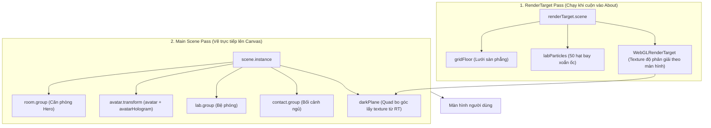
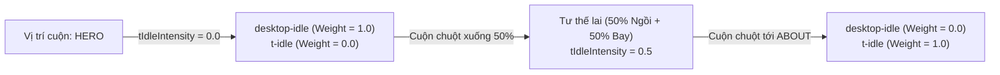

# BÁO CÁO PHÂN TÍCH TOÀN DIỆN HỆ THỐNG 3D TRONG PORTFOLIO-2025
*Dự án tham chiếu: `/home/kis/portfolio/portfolio-2025`*

---

## MỤC LỤC
1. [Tổng Quan Kiến Trúc Render 3D](#1-tổng-quan-kiến-trúc-render-3d)
2. [Giải Mã: Tại Sao File .GLB Lên Web Lại Có Màu & Chiều Sâu Đẹp?](#2-giải-mã-tại-sao-file-glb-lên-web-lại-có-màu--chiều-sâu-đẹp)
   - 2.1. Kỹ thuật Baked Texture (Nướng sẵn ánh sáng vào ảnh)
   - 2.2. Kỹ thuật Matcap (Material Capture cho nhân vật cử động)
   - 2.3. Kỹ thuật Procedural Shaders (Tô màu toán học cho Hologram & Lab)
3. [Phân Tích Chi Tiết 4 Model .GLB](#3-phân-tích-chi-tiết-4-model-glb)
   - 3.1. `avatar.glb` (Nhân vật chính & Hệ thống 25 xương)
   - 3.2. `room.glb` (Phòng làm việc Hero & 15 mesh con)
   - 3.3. `lab.glb` (Bệ phóng Hologram About)
   - 3.4. `contact.glb` (Bối cảnh phòng ngủ Contact)
4. [Cơ Chế Hoạt Hình: Animation Clips Blending & Dual-Mixer](#4-cơ-chế-hoạt-hình-animation-clips-blending--dual-mixer)
   - 4.1. Danh mục 7 Animation Clips của Avatar
   - 4.2. Cơ chế pha trộn trọng số theo Scroll & Event
   - 4.3. Bản chất kiến trúc Dual-Mixer (2 bộ trộn chạy song song)
5. [Hệ Thống Góc Quay (Camera Waypoints) & Chuyển Cảnh GSAP](#5-hệ-thống-góc-quay-camera-waypoints--chuyển-cảnh-gsap)
   - 5.1. Mouse Parallax & Weighted Average Camera
   - 5.2. Bảng tọa độ Camera & Transform qua các giai đoạn
6. [Tương Tác Đồ Vật & Procedural Effects](#6-tương-tác-đồ-vật--procedural-effects)

---

## 1. TỔNG QUAN KIẾN TRÚC RENDER 3D

Trong `portfolio-2025`, toàn bộ trang web sử dụng **1 canvas duy nhất** phủ toàn màn hình (`WebGLRenderer`), nhưng bên dưới lại vận hành **2 Scene đồ họa song song**:



- **`scene.instance` (`src/three/core/scene.ts`):** Không gian 3D chính chứa toàn bộ các khối mô hình.
- **`renderTarget.scene` (`src/three/core/renderTarget/index.ts`):** Scene phụ độc lập chuyên vẽ mặt sàn công nghệ (`gridFloor`) và các hạt ánh sáng (`labParticles`) với màu nền xanh `#0169b4` ra một bộ đệm ảnh ngầm (`WebGLRenderTarget`).
- **`darkPlane` (`src/three/objects/dark-plane/index.ts`):** Một tấm phẳng Fullscreen Quad đặt tại `renderOrder = 10`. Nó lấy texture từ `WebGLRenderTarget` ở trên và dùng shader cắt thành khung chữ nhật bo góc, mở rộng dần theo thanh cuộn (`about.in`), tạo ra hiệu ứng một "cửa sổ không gian" mở ra phía sau nhân vật.

---

## 2. GIẢI MÃ: TẠI SAO FILE .GLB LÊN WEB LẠI CÓ MÀU & CHIỀU SÂU ĐẸP?

Nếu kiểm tra trong code `scene.ts`, **không có bất kỳ bóng đèn 3D nào (`DirectionalLight`, `PointLight`, `AmbientLight`)**.
File `.glb` thực chất chỉ xuất khung lưới hình học (mesh), tọa độ UV và tên object. Toàn bộ ánh sáng và màu sắc được xử lý bằng 3 phương pháp tối ưu hóa cao:

### 2.1. Kỹ thuật Baked Texture (Nướng sẵn ánh sáng vào Texture)
- **Áp dụng cho:** `room.glb`, `contact.glb`, và phần đầu tóc `head.webp`.
- **Nguyên lý:** Trong Blender, toàn bộ ánh sáng phức tạp, bóng đổ mềm (soft shadow), phản xạ gián tiếp (Global Illumination) được tính toán bằng render engine Cycles, sau đó **"nướng" (Bake)** cố định thành các file ảnh phẳng:
  - `room.webp` (gói toàn bộ phòng).
  - `contact.webp` (gói bối cảnh ngủ).
  - `head.webp` (gói chi tiết đầu/tóc).
- **Trên Web:** Three.js chỉ việc gán bằng `MeshBasicMaterial({ map: texture })` (Unlit shader).
- **Ưu điểm:** GPU điện thoại hay máy tính yếu không tốn bất kỳ chi phí tính toán bóng đổ thời gian thực nào nhưng hình ảnh vẫn đạt chất lượng cao như phim 3D.

### 2.2. Kỹ thuật Matcap (Material Capture cho nhân vật cử động)
- **Áp dụng cho:** Các bộ phận cử động của `avatar.glb`.
- **Tại sao không Bake cho Avatar?** Vì nhân vật vẫy tay, gõ phím, cúi người liên tục. Nếu nướng bóng cứng lên tay/áo, khi tay giơ lên trời bóng đổ sẽ bị sai hướng vật lý.
- **Giải pháp:** Chia cơ thể `avatar.glb` thành các mesh riêng theo màu: `black` (quần), `gray` (áo), `skin` (da), `white` (giày). Chuẩn bị 4 ảnh cầu Matcap tương ứng (`matcap-black.webp`, `matcap-gray.webp`, v.v.).
- **Nguyên lý Shader (`avatar-matcap/fragment.glsl`):**
  Shader lấy hướng pháp tuyến bề mặt (Normal Vector) so sánh với hướng nhìn của Camera để tra cứu tọa độ UV trên quả cầu Matcap:
  $$\vec{UV} = \left( \vec{Normal} \cdot \vec{X}_{cam}, \; \vec{Normal} \cdot \vec{Y}_{cam} \right) \times 0.495 + 0.5$$
- **Ưu điểm:** Bất kể nhân vật vặn vẹo hay camera xoay góc nào, bề mặt vẫn phản chiếu ánh sáng studio và bóng cong mềm mại tự nhiên như đất sét (clay), chi phí tính toán cực nhẹ.

### 2.3. Kỹ thuật Procedural Shaders (Tô màu bằng toán học)
- **Áp dụng cho:** Hologram, tia điện (`labElectric`), nón sáng (`labShine`), mặt sàn lưới (`gridFloor`).
- Màu sắc và hiệu ứng quét sọc, phát sáng viền (Fresnel) được tính bằng mã GLSL thời gian thực thay vì dùng ảnh texture, cho phép thay đổi màu sắc và tần số quét theo nhịp cuộn trang.

---

## 3. PHÂN TÍCH CHI TIẾT 4 MODEL .GLB

### 3.1. `avatar.glb` — Nhân vật chính
- **File path:** `src/assets/models/avatar.glb`
- **Kích thước World:** Cao `~4.3m` (trục Y từ `2.03` đến `6.33`), Scale gốc: `[1.038, 1.038, 1.038]`.
- **Cấu trúc Meshes:**
  1. `black` (`Y: 2.81 → 4.11`): Quần tây / nếp gấp đen.
  2. `gray` (`Y: 2.07 → 5.08`): Áo khoác xám.
  3. `skin` (`Y: 2.50 → 5.11`): Vùng da mặt, cổ, hai bàn tay.
  4. `white` (`Y: 2.03 → 2.68`): Giày trắng.
  5. `head` (`Y: 4.99 → 6.33`): Hộp sọ và tóc, gán shader riêng với `head.webp`.
  6. `face` (`Y: 5.27 → 6.02`): Tấm mesh phẳng đặt sát phía trước đầu (`renderOrder = 25`, tắt `depthTest`/`depthWrite`). Sử dụng spritesheet `face-spritesheet.png` gồm lưới $4 \times 4$ (16 khung biểu cảm: nháy mắt, tự hào, ngủ, ngạc nhiên).
  7. `brain`: Tồn tại trong GLB nhưng bị xóa khỏi nhân vật chính khi khởi tạo (`mesh.remove(brain)`), chỉ được dùng để ghép vào bản Hologram.
- **Hệ thống Xương (`armature` - 25 Bones):**
  - Trục thân: `hipsBone` $\rightarrow$ `spineBone` $\rightarrow$ `spine1Bone` $\rightarrow$ `spine2Bone` $\rightarrow$ `headBone`.
  - Tay trái: `leftShoulderBone` $\rightarrow$ `leftArmBone` $\rightarrow$ `leftForeArmBone` $\rightarrow$ `leftHandBone` $\rightarrow$ `leftHandIndex1Bone` $\rightarrow$ `leftHandIndex2Bone`.
  - Tay phải: `rightShoulder` $\rightarrow$ `rightarmBone` $\rightarrow$ `rightForearmBone` $\rightarrow$ `rightHandBone` $\rightarrow$ `bone-right-hand` $\rightarrow$ `rightHandIndex2Bone`.
    *(Đặc biệt: Xương `bone-right-hand` được code lấy vị trí World mỗi khung hình để kéo con chuột máy tính chạy theo).*
  - Chân trái & phải: `leftUpLegBone` / `rightUpLegBone` $\rightarrow$ `leftLegBone` / `rightLegBone` $\rightarrow$ `leftFootBone` / `rightFootBone` $\rightarrow$ `leftToeBaseBone` / `rightToeBaseBone`.

---

### 3.2. `room.glb` — Căn phòng Hero
- **File path:** `src/assets/models/room.glb`
- **Kích thước World:** Rộng `~7.1m` ($X: -2.52 \rightarrow 4.60$), Cao `~5.5m` ($Y: 0 \rightarrow 5.48$), Sâu `~7.4m` ($Z: -2.23 \rightarrow 5.32$).
- **Chi tiết 15 Mesh con:**
  - `room`: Tường, sàn gỗ, bàn làm việc chính (gán `roomMaterial`).
  - `chair`: Ghế xoay văn phòng. Khi cuộn sang About, ghế xoay văng ra bằng GSAP: `rotation = (-0.9, -1.1, -1.3)`.
  - `carpet`: Thảm trải sàn (`renderOrder = -10`, tắt `depthWrite` để không che bóng ghế).
  - `mouse`: Chuột máy tính, được code gán vị trí theo xương tay phải.
  - `desktop-plane-0` & `desktop-plane-1`: Hai màn hình máy tính (gộp chung một geometry trong `desktops.ts`, gán attribute `scrollIntensity` và `messageIntensity` để cuộn dòng code và nháy notification).
  - `penguin`, `penguin-wing-left`, `penguin-wing-right`: Chim cánh cụt tương tác (nhấp chuột để vỗ cánh và bắn tim).
  - `music`: Máy phát nhạc (nhấp chuột để bật âm thanh và thả nốt nhạc).
  - `shelf`, `plant`, `frame`, `blackboard`: Đồ trang trí nội thất.
  - `shadow-catcher`: Tấm phẳng nền (`renderOrder = -1000`) dùng shader hòa trộn màu nền `beigeLight` với `room-shadow.webp`.

---

### 3.3. `lab.glb` — Bệ phóng Hologram (About)
- **File path:** `src/assets/models/lab.glb`
- **Vị trí cố định:** `lab.group.position = (0, 0, 6)`.
- **4 Mesh cấu thành:**
  1. `base`: Đế tròn bệ phóng (`renderOrder = 20`, bán kính `1.06m`), dùng `diffuse-map.png`.
  2. `display`: Bảng hiển thị thông số điện tử trước bệ phóng, đi kèm module `DigitalNumbers` chạy từ `000` đến `100` theo `aboutProgress`.
  3. `electric`: Vòng tia điện (`renderOrder = 25`), độ sáng tăng giảm theo tốc độ lướt cuộn chuột (`velocity * 0.75`).
  4. `shine`: Nón ánh sáng bao quanh nhân vật (`renderOrder = 30`, `DoubleSide`, tắt `depthTest`).
- **Thành phần bổ sung bằng code:**
  - `labPlane`: Mặt phẳng quét ngang (`1.5m × 1.0m`, `renderOrder = 24`) quét dọc từ chân lên đầu nhân vật ($Y: -0.2 \rightarrow 4.5$) theo tiến độ cuộn trang.
  - `labParticles`: Hệ thống 50 hạt ánh sáng bay xoắn ốc từ đáy bệ phóng lên trời.

---

### 3.4. `contact.glb` — Bối cảnh ngủ (Contact)
- **File path:** `src/assets/models/contact.glb`
- **Vị trí cố định:** Đặt sâu ở tầng đáy `contact.group.position = (1, -13, 0)`, xoay `rotation.y = -0.8 rad`.
- **Thành phần:**
  - `base`: Khối giường/bàn ngủ nhân vật, bọc texture `contact.webp`.
  - `shadow-catcher`: Mặt phẳng hứng bóng (`renderOrder = -1000`).
  - `sleepingSprite`: 3 tấm billboard chữ `Zzz` bay lên không trung, tự biến mất khi nhân vật thức dậy.

---

## 4. CƠ CHẾ HOẠT HÌNH: ANIMATION CLIPS BLENDING & DUAL-MIXER

### 4.1. Danh mục 7 Animation Clips của Avatar

| Clip trong GLB | Thời lượng | Kiểu lặp | Vai trò & Kịch bản kích hoạt |
| :--- | :---: | :---: | :--- |
| **`idle`** | `3.375s` | `LoopPingPong` | Ngồi gõ bàn phím và rê chuột ở Hero. |
| **`wave`** | `2.708s` | `LoopOnce` | Vẫy tay chào khi mới load trang, mặt chuyển sang tự hào (`proud-0`), tự hòa mượt về `idle`. |
| **`left-desktop`** | `4.792s` | `LoopOnce` | Mỗi 12–18s quay sang gõ màn hình bên trái (phát tiếng bàn phím tại giây 1.6). |
| **`t-idle`** | `1.667s` | `LoopPingPong` | Tư thế bay lơ lửng chữ T trong lồng kính Hologram ở About. |
| **`sleeping`** | `2.083s` | `LoopPingPong` | Tư thế nằm gục ngủ ở Contact (kèm tiếng ngáy). |
| **`wake-up`** | `0.833s` | `LoopOnce` | Giật mình tỉnh giấc khi người dùng cuộn tới Contact (phát tiếng `gasp`, đổi mặt). |
| **`contact-idle`** | `2.083s` | `LoopPingPong` | Sau khi thức dậy, ngồi nhìn người dùng mỉm cười và chớp mắt. |

---

### 4.2. Cơ Chế Pha Trộn Trọng Số (Weight Blending theo Scroll)

Thay vì chuyển đổi clip đột ngột, Three.js cho phép gán `weight` (từ `0.0` đến `1.0`) cho từng hành động. Tất cả các clip đều được bấm `play()`, việc cử động ra sao do tổng hợp trọng số quyết định:



- **Pha trộn theo cuộn chuột (Hero $\rightarrow$ About):**
  $$\text{Weight}_{\text{idle}} = (1 - \text{tIdleIntensity}) \times (1 - \text{wavingStrength})$$
  $$\text{Weight}_{\text{t-idle}} = \text{tIdleIntensity}$$
  Khi người dùng cuộn chuột, biến `tIdleIntensity` trượt từ `0 → 1`. Xương nhân vật tự động nội suy từ tư thế ngồi cong chân sang tư thế đứng thẳng lơ lửng một cách mượt mà theo từng pixel cuộn.

- **Pha trộn sự kiện đột xuất (`crossFadeTo`):**
  Khi xảy ra biến cố (ví dụ `wake-up`), action cũ hòa tan vào action mới trong khoảng thời gian xác định (ví dụ `0.2s`):
  `sleepingAction.crossFadeTo(wakeUpAction, 0.2);`

---

### 4.3. Bản Chất Kiến Trúc Dual-Mixer (2 Bộ Trộn Chạy Song Song)

Hiệu ứng quét tia X / Hologram ở mục About tạo ra cảm giác nửa thân trên là người thật, nửa thân dưới là khung lưới điện tử xanh trong suốt (thấy cả bộ não bên trong). 

**Tại sao phải dùng 2 Mixer?**
Trong WebGL, một SkinnedMesh đơn lẻ không thể vừa hiển thị chất liệu đục (Matcap Opaque), vừa hiển thị chất liệu phát sáng trong suốt hai mặt (`AdditiveBlending`, `DoubleSide`, lộ `brain`) mà không bị lỗi sắp xếp độ sâu (Depth Sorting Artifacts).

**Cách tác giả hiện thực:**
Tạo ra **2 nhân vật độc lập đứng trùng khít nhau**:
1. **Nhân vật thật (`avatar`):** Được điều khiển bởi `mixer`. Shader kiểm tra cao độ thế giới: phần nào **nằm dưới** vạch quét `uProgress` thì ẩn đi (`alpha = 0`).
2. **Nhân vật Hologram (`avatarHologram`):** Được clone toàn bộ xương, gộp thêm cả mesh `brain`, điều khiển bởi `hologramMixer`. Shader làm ngược lại: phần nào **nằm dưới** vạch quét `uProgress` thì sáng rõ (`alpha = 1`).

**Đồng bộ hóa tuyệt đối từng Frame:**
Trong vòng lặp render (`tick`), cả 2 mixer được cập nhật cùng một thời gian delta:
```ts
const delta = gsap.ticker.deltaRatio(60);
mixer.update(delta / 60);
hologramMixer.update(delta / 60);
```
Mọi sự thay đổi trọng số clip (`setWeight`) đều được áp dụng đồng thời cho cả hai. Kết quả là nhân vật thật và nhân vật Hologram cử động trùng khớp nhau 100%, tạo ra ảo giác hoàn hảo rằng chỉ có một cơ thể duy nhất đang bị máy quét xuyên qua.

---

## 5. HỆ THỐNG GÓC QUAY (CAMERA WAYPOINTS) & CHUYỂN CẢNH GSAP

### 5.1. Mouse Parallax & Weighted Average Camera
- Camera sử dụng: `PerspectiveCamera(38, aspect, 0.01, 100)`.
- Camera được lồng vào một `parallaxGroup`. Chuột di chuyển trên màn hình điều khiển vị trí của group này với độ trễ mượt:
  $$\Delta X = (\text{cursor.x} - \text{group.x}) \times \text{PARALLAX\_SPEED} \times 0.1 \times \Delta t$$
- **Nội suy Waypoints:** Thay vì tính toán quỹ đạo camera phức tạp, vị trí camera và điểm nhìn tại bất kỳ thời điểm nào là **trung bình có trọng số** của các cảnh đang hiển thị:
  $$\vec{P}_{\text{cam}} = \frac{\sum (w_i \times \vec{P}_i)}{\sum w_i}, \quad \vec{F}_{\text{cam}} = \frac{\sum (w_i \times \vec{F}_i)}{\sum w_i}$$

---

### 5.2. Bảng Tọa Độ Camera & Transform Qua Từng Giai Đoạn

| Giai đoạn | Viewport | Vị trí Camera (`position`) | Điểm nhìn (`focus`) | Tọa độ & Góc xoay Model |
| :--- | :--- | :--- | :--- | :--- |
| **1. HERO** | **Landscape** (Desktop) | `(0, 6.0, 10.0)` | `(0, 3.0, 0.0)` | • `room.group`: pos `(2, 0, 0)`, rot `(0, -2.3, 0)` (`-131.8°`)<br>• `avatar`: pos `(2, 0, 0)`, rot `(0, -2.3 + π/2, 0)` (`-41.8°`) |
| | **Portrait** (Mobile) | `(0, 8.2, 16.0)` | `(0, 5.2, 0.0)` | • `room.group`: pos `(0, 0, 0)`, rot `(0, -2.1, 0)` (`-120.3°`)<br>• `avatar`: pos `(0, 0, 0)`, rot `(0, -2.1 + π/2, 0)` (`-30.3°`) |
| **Chuyển HERO $\rightarrow$ ABOUT** | Cả hai | Trượt lùi và hạ thấp dần | Hướng dần về tâm Lab | • `room.group`: bay lên `Y = 5.7`, scale thu nhỏ còn `0.85`<br>• `chair`: xoay văng ra `(-0.9, -1.1, -1.3)`<br>• `avatar`: trượt từ ghế `(2, 0, 0)` ra tâm Lab `(0, 0, 6)`, xoay mặt về camera `(0, -π, 0)` |
| **2. ABOUT** | **Landscape** | `(0, 4.5, 15.5)` | `(0, 2.2, 6.0)` | • `lab.group` & `avatar`: cố định tại `(0, 0, 6)`<br>• `labPlane`: quét từ `Y = -0.2` lên `Y = 4.5`<br>• `avatarHologram`: hiện dần theo vạch quét |
| | **Portrait** | `(0, 4.75, 19.5)` | `(0, 0.8, 6.0)` | Như trên, camera lùi xa hơn để bao quát màn hình dọc |
| **3. CONTACT** | **Landscape** | `(0, -8.5, 9.0)` *(+4 Y khi bắt đầu)* | `(0, -10.5, 0.0)` | • `contact.group`: pos `(1, -13, 0)`, rot `(0, -0.8, 0)`<br>• `avatar`: chuyển vị trí xuống `(0, -13, 0)`<br>• Khi cuộn tới `top 15%`, gọi `wakeUp()` |
| | **Portrait** | `(0, -8.0, 12.0)` | `(0, -9.4, 0.0)` | Góc nhìn trực diện hơn cho thiết bị di động |

---

## 6. TƯƠNG TÁC ĐỒ VẬT & PROCEDURAL EFFECTS

Bên cạnh chuyển động của nhân vật, cảnh Hero có các tương tác vi mô giúp thế giới 3D sống động:
1. **Chuột máy tính bám theo tay (`mouse.ts`):** 
   Mỗi khung hình, code đọc tọa độ thực của xương `bone-right-hand`, chuyển thành tọa độ tương đối của bàn. Nếu tay nằm trong giới hạn mặt bàn ($X \in [-0.9, -0.7]$, $Z \in [-0.6, -0.28]$), mesh `mouse` sẽ tự trượt theo bàn tay của nhân vật.
2. **Màn hình code tự cuộn (`desktops.ts`):**
   Khi nhân vật đang ở trạng thái gõ phím `desktop-idle`, mỗi 3–5 giây shader màn hình sẽ tự dịch chuyển UV `uScrollDepth` và phát kèm âm thanh con lăn chuột (`mouseWheel`).
3. **Chim cánh cụt tương tác (`penguin.ts`):**
   Sử dụng tia va chạm (`Raycaster`) kiểm tra click. Khi người dùng bấm vào chú chim cánh cụt: mesh chim nhảy lên `y = 2`, hai cánh đập liên tục 7 chu kỳ (`rotation.x = ±0.4`) và một icon trái tim màu đỏ bay lên trên đầu.
4. **Máy đĩa phát nhạc (`music.ts` & `notes.ts`):**
   Nhấp chuột vào máy phát nhạc sẽ bật/tắt luồng âm thanh nền của website, đồng thời kích hoạt 3 tấm phẳng Shader phát nốt nhạc bay lượn ngẫu nhiên.

---
*Báo cáo được trích xuất hoàn chỉnh từ mã nguồn của dự án `/home/kis/portfolio/portfolio-2025`.*

